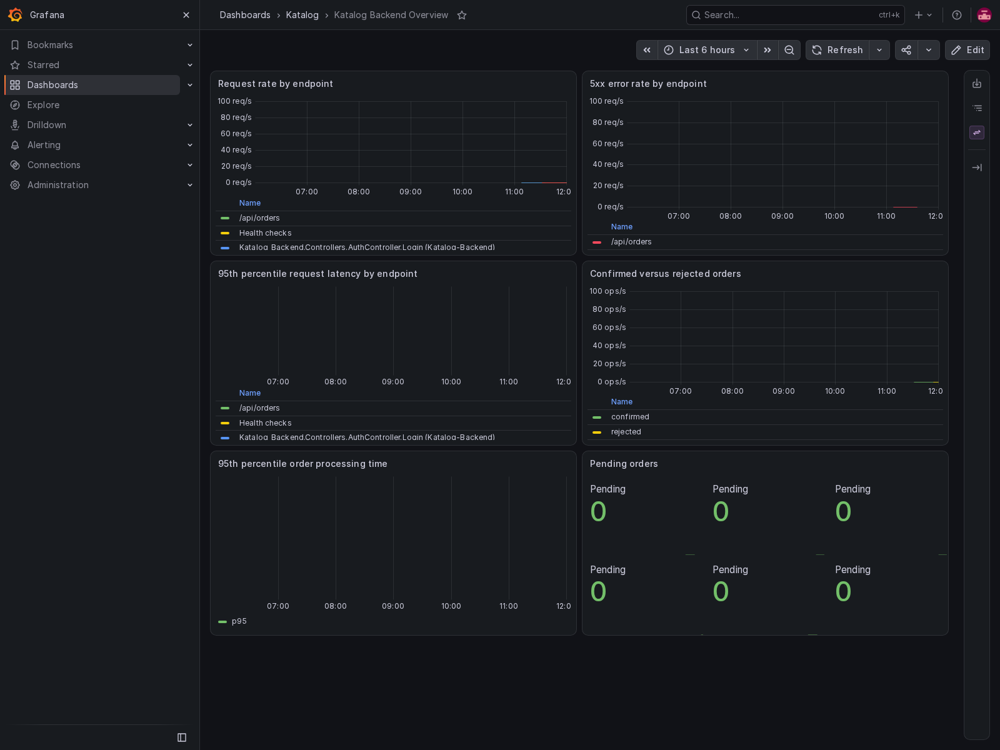
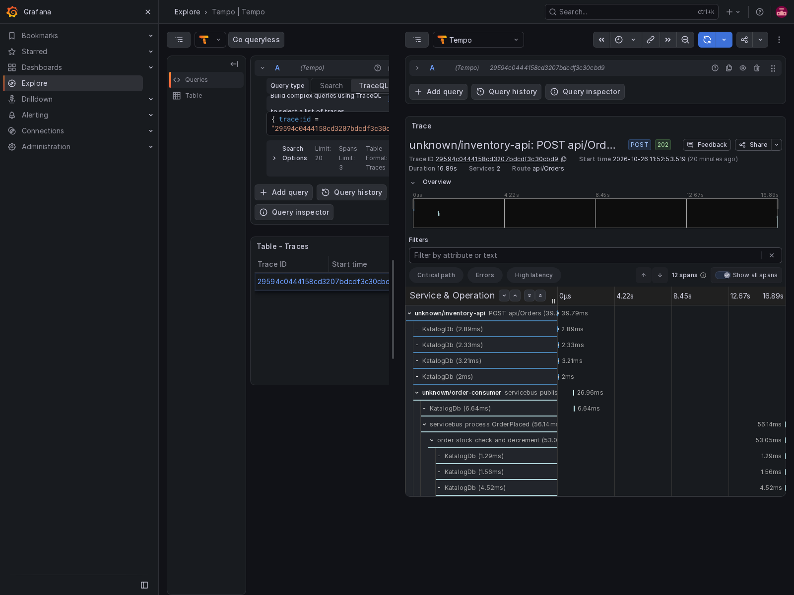

# Katalog-Backend

An e-commerce backend built with **ASP.NET Core (.NET 10)**, **Entity Framework Core**, **SQL Server**, and **Azure Service Bus**.

---

## Architecture & Services

The application is containerized and managed via Docker Compose (`compose.yaml`):

| Service | Container Name | Description | Ports |
| :--- | :--- | :--- | :--- |
| **`sqlserver`** | `katalog-sqlserver` | Microsoft SQL Server 2022 database with a **named volume** (`sqlserver_data`) ensuring persistent data across restarts. | `1433:1433` |
| **`sqledge`** | `katalog-sqledge` | Azure SQL Edge container providing lightweight database backend for the Service Bus emulator. | Internal |
| **`servicebus-emulator`**| `katalog-servicebus-emulator` | Local Azure Service Bus emulator using `mcr.microsoft.com/azure-messaging/servicebus-emulator:latest`. Pre-configured via `emulator/Config.json`. | `5672:5672` (AMQP)<br>`5300:5300` (Management) |
| **`api`** | `katalog-api` | ASP.NET Core Web API running as a **non-root user** (`app`, UID 1654). Handles HTTP requests and health checks. Background consumers are disabled (`BackgroundServices__ConsumerEnabled=false`). | `5297:8080` |
| **`consumer`** | Compose-managed | Dedicated background worker process consuming session-enabled `orders-queue` messages and processing transactional outbox messages. Scalable independently of the API with `docker compose up --scale consumer=N`. | Internal |

The consumer's `AzureServiceBus__MaxConcurrentSessions`, `AzureServiceBus__MaxConcurrentCallsPerSession`, and `AzureServiceBus__SessionIdleTimeoutSeconds` settings are configurable through environment variables. The defaults preserve strict single-session processing; increase them for higher throughput after validating database concurrency and idempotency under load.

---

## Getting Started

### 1. Configure Environment Variables
Copy `.env.example` to `.env`:
```bash
cp .env.example .env
```
*(Note: Never commit `.env` containing sensitive credentials to source control. It is explicitly listed in `.gitignore`.)*

### 2. Start Services with Docker Compose
Start all services in detached mode:
```bash
docker compose up -d
```

To view logs:
```bash
docker compose logs -f api
docker compose logs -f consumer
```

Grafana is available at `http://localhost:${GRAFANA_PORT:-3000}` using the
`GRAFANA_ADMIN_USER` and `GRAFANA_ADMIN_PASSWORD` values from `.env`. The local
Grafana instance is provisioned with Prometheus, Tempo, and Loki data sources.
Trace-to-log and log-to-trace links are configured from the repository files;
no Grafana UI setup is required. The provisioned `Katalog Backend Overview`
dashboard includes endpoint request rate, 5xx error rate, p95 request latency,
order outcomes, p95 order processing time, and current Pending orders. The
application sends all telemetry to the local OpenTelemetry Collector and does
not connect directly to a hosted or storage backend. A provisioned Grafana
alert named `Orders have stayed Pending` fires when the Pending-order gauge
remains above zero for two minutes. Two minutes is long enough to ignore
normal short-lived asynchronous processing and transient queue delay, while
still detecting a stalled consumer or unavailable messaging/database path
quickly. The alert is a warning because a small backlog can be expected during
brief load spikes; operators should investigate the consumer and dependencies
before treating it as an outage.

---

## Health Check Endpoints

The API exposes ASP.NET Core health check endpoints:

* **Liveness Probe**: `GET http://localhost:5297/health/live`
  * Verifies the process is alive and responsive.
  * Returns: `200 OK` (`{"status": "Healthy"}`)

* **Readiness Probe**: `GET http://localhost:5297/health/ready`
  * Verifies connectivity to the database (`ApplicationDbContext.CanConnectAsync()`) and Azure Service Bus queue.
  * Returns: `200 OK` when dependencies are reachable or `503 Service Unavailable` on failure.

---

## Stage 3: Consumer Recovery Testing

The API and Consumer are decoupled into separate processes. This enables testing **Consumer Recovery** (fault tolerance when the message consumer is temporarily unavailable):

1. **Simulate Consumer Downtime**:
   Stop **only** the consumer container:
   ```bash
   docker compose stop consumer
   ```
2. **Publish Orders via the API**:
   Submit orders to the API. Because the database and Service Bus emulator remain active, events are placed onto the Service Bus queue without loss.
3. **Resume Consumer**:
   Start the consumer container back up:
   ```bash
   docker compose start consumer
   ```
   The consumer re-connects and drains the backlog of messages.

> ⚠️ **CRITICAL NOTE ON EMULATOR LIFECYCLE**:  
> The Azure Service Bus emulator retains message state in memory/volatile container storage and **loses all queued messages if its container is restarted**.  
> **During Consumer Recovery tests, stop or restart ONLY the `consumer` container (`docker compose stop consumer`), NEVER the `servicebus-emulator` container.**

---

## Azure Service Bus Emulator: Known Limitations

When developing locally against `mcr.microsoft.com/azure-messaging/servicebus-emulator`, be aware of the following known emulator limitations:

1. **Volatile Message Storage Across Restarts**:
   The emulator does not persist message payloads across container restarts. Any messages published prior to restarting the emulator container are lost.
2. **Pre-defined Entity Configuration**:
   All namespaces, queues (including session requirements), topics, and subscriptions must be declared upfront in `emulator/Config.json`. Dynamically creating entities at runtime via the SDK is not fully supported without the dedicated management HTTP endpoint.
3. **Separate Management HTTP Port**:
   Management operations (`ServiceBusAdministrationClient`) communicate over HTTP port `5300`, whereas standard message publishing and consuming (`ServiceBusClient`) use AMQP on port `5672`. The connection string format for local administration differs from standard AMQP messaging.
4. **No Cross-Entity Transactions**:
   Transactions spanning multiple entities (e.g. sending to topic A and acknowledging from queue B in a single transaction) are not supported by the emulator.
5. **Relaxed Development Authentication**:
   The emulator operates with `UseDevelopmentEmulator=true;SharedAccessKey=SAS_KEY_VALUE;` and does not support Azure Entra ID (Azure AD), OAuth tokens, or role-based access control (RBAC).
6. **No Premium Tier Features**:
   Features such as geo-disaster recovery, partitioning, customer-managed keys (CMK), and message migration across namespaces are unavailable in the local emulator.
7. **One-Hour Message TTL Limit**:
   The emulator rejects queue configurations with a default message time-to-live longer than one hour, so the committed queue configuration uses `PT1H`.

## Testing Requirements

The complete NUnit suite remains the CI gate. It runs on every push and pull
request, and the `container-smoke` job runs the Docker smoke test on every pull
request:

```bash
dotnet test Katalog-Backend.slnx --configuration Release
./scripts/container-smoke-test.sh
```

The container smoke test starts the Compose stack, waits for `/health/ready`,
seeds product `1`, verifies `GET /api/products/1` returns `200 OK`, stops SQL
Server and verifies that `/health/ready` returns `503` while `/health/live`
continues to return `200`, then removes the stack and its volumes. A failed
NUnit test or smoke assertion exits non-zero and blocks the pull request check.

To demonstrate the pipeline gate without changing production code, create a
temporary failing NUnit test on a throwaway branch, push it, and open a pull
request. The required `build-and-test` check must fail before merge. Remove the
test, push the correction, and confirm the replacement run is green:

```bash
gh run list --workflow build-test.yaml --limit 10
gh run view 40307943777 --web
gh run view 40308856377 --web
```

The workflow audit page is:
`https://github.com/Ruran8wa/Katalog-Backend/actions/workflows/build-test.yaml`.
The deliberately failing run is
[`40307943777`](https://github.com/Ruran8wa/Katalog-Backend/actions/runs/40307943777).
The corrected green run, including the container smoke test, is
[`40308856377`](https://github.com/Ruran8wa/Katalog-Backend/actions/runs/40308856377).
Do not merge the deliberately failing commit.

### Observability NUnit tests

`Katalog-Backend.Tests/Observability/TelemetryTests.cs` uses the OpenTelemetry
in-memory exporter to verify that producer and consumer spans retain one trace
ID. It also listens to the orders-processed counter and verifies the confirmed
and insufficient-stock rejection measurements:

```bash
dotnet test Katalog-Backend.Tests/Katalog-Backend.Tests.csproj \
  --configuration Release --filter FullyQualifiedName~TelemetryTests
```

### Local end-to-end observability check

From a clean clone, copy `.env.example` to `.env` and start the stack:

```bash
cp .env.example .env
docker compose up -d
```

Register or log in through `/api/auth`, place an order with
`POST /api/orders` using `{"variantId":1,"quantity":1}`, and open
`http://localhost:3000`. In the `Katalog Backend Overview` dashboard, confirm
the order counters and Pending gauge. Open the matching trace in Tempo and
confirm the API request, Service Bus publish, consumer processing, and database
update spans. Open the consumer log in Loki and use its `trace_id` link to jump
to the same Tempo trace.

To verify telemetry is non-blocking, stop only the Collector, place another
order, and confirm the API still returns `202 Accepted` and the consumer still
confirms or rejects the order:

```bash
docker compose stop otel-collector
./scripts/collector-outage-test.sh
docker compose start otel-collector
```

### Observed load test

Run the Stage 3 buffering scenario against the local Compose stack:

```bash
./scripts/observability-load-test.sh
```

The script resets variant `1` to six units and submits twenty purchases. After
the consumer drains the queue, Grafana must show six `confirmed` and fourteen
`rejected` orders, with `insufficient_stock` as the rejection reason. Capture
the dashboard and one API-to-consumer trace from Grafana for the review record:




